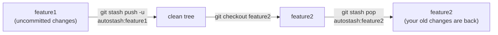
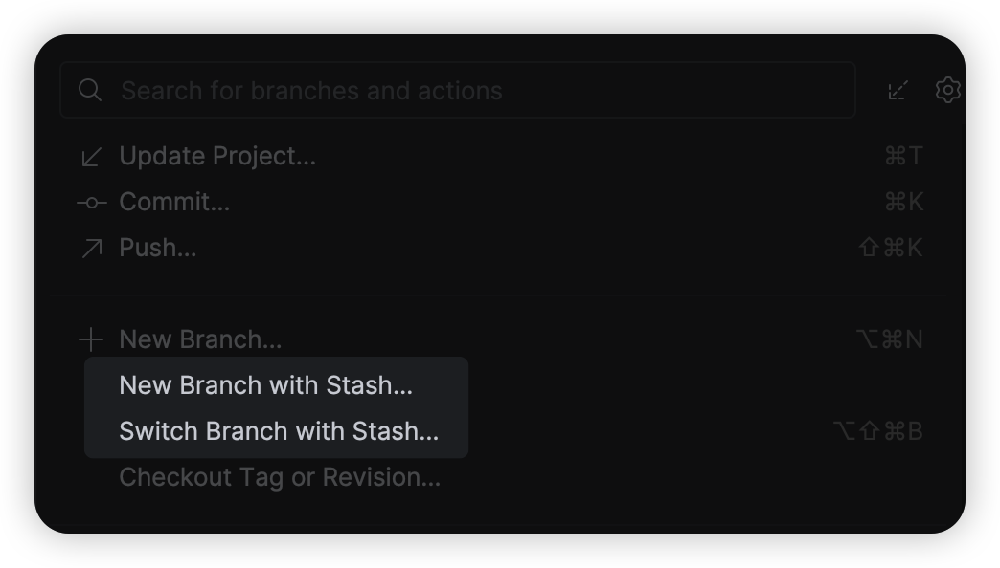

# Branch Stash Switcher

**Per-branch autostash for JetBrains IDEs.** Leave a branch with uncommitted work, come back later, and find everything exactly where you left it.

You're on `feature1` with half-done changes and need to jump to `feature2`. The usual dance is *stash → checkout → remember which stash was yours → unstash*. This plugin does it in one click:



## Features

- **Switch Branch with Stash…** — parks the current branch's changes in its own stash, checks out the target branch and restores the stash that was parked for it earlier.
- **New Branch with Stash…** — parks the current branch's changes and creates a fresh, clean branch from the current commit.
- **Untracked files included**: new files stay with the branch they belong to instead of following you around.
- **Only touches its own stashes**: stashes are tagged `autostash:<branch>`. Stashes you made by hand are never popped.
- **Safe by default**: unsaved editors are saved first. If the checkout fails, your changes go straight back onto the original branch. If restoring conflicts, the stash is kept so nothing is lost.

## Where to find it

Both actions sit next to the built-in branch actions:

<p align="center">
  
</p>

| Place | Location |
|---|---|
| Branch widget popup (toolbar) | below **New Branch…** |
| **Git** menu in the main menu bar | next to **Branches…** / **New Branch…** |
| Right-click → **Git** submenu | next to **Branches…** / **New Branch…** |

**Switch Branch with Stash…** also has a shortcut: `⌥⇧⌘B` on macOS, `Ctrl+Alt+Shift+B` on Windows/Linux. Search for "with Stash" in *Settings › Keymap* to change it.

## How it works

| Step | Switch | New branch |
|---|---|---|
| 1 | Save all open documents | same |
| 2 | If the tree is dirty: `git stash push --include-untracked -m "autostash:<current>"` | same |
| 3 | `git checkout <target>` | `git checkout -b <name>` |
| 4 | Find the newest `autostash:<target>` and `git stash pop` it | — (new branch starts clean) |
| 5 | Refresh the IDE (VFS, changes view) and show a notification | same |

If step 3 fails, the stash from step 2 is popped back right away, so you end up where you started.
All commands run through the IDE's own Git integration, so they appear in the Git console and use your configured Git executable.

You can always inspect what's parked with:

```bash
git stash list | grep autostash:
```

## Installation

A ready-to-install build is in the repo: [`dist/branch-stash.zip`](dist/branch-stash.zip).

**1. Get the zip.** Use one of these:

- Download it from GitHub: open [`dist/branch-stash.zip`](dist/branch-stash.zip) and click **Download raw file**.
- Download it with curl:

  ```bash
  curl -L -o ~/Downloads/branch-stash.zip https://github.com/PerfilovStanislav/branch-stash/raw/main/dist/branch-stash.zip
  ```

- Clone the repo. The zip is then at `branch-stash/dist/branch-stash.zip`:

  ```bash
  git clone git@github.com:PerfilovStanislav/branch-stash.git
  ```

> Keep the file zipped: the IDE installs the `.zip` itself. Safari may unpack downloads automatically. If that happens, use curl or the clone instead.

**2. Install it.** In the IDE open **Settings › Plugins**, click **⚙** (next to the *Marketplace* / *Installed* tabs) › **Install Plugin from Disk…**, and pick `branch-stash.zip`.

**3. Restart the IDE** when prompted. The actions appear in the branch popup and the Git menus (see [Where to find it](#where-to-find-it)).

To **update**, repeat the same steps with the new zip; the IDE replaces the old version. To **remove** the plugin, go to **Settings › Plugins › Installed › Branch Stash Switcher › Uninstall**.

**Compatibility:** JetBrains IDEs 2026.2+ (build 262+) with the bundled Git plugin: GoLand, IntelliJ IDEA, PhpStorm, WebStorm, PyCharm, etc.

## Building from source

The build uses the Gradle wrapper and compiles against a locally installed GoLand (`/Applications/GoLand.app`), so nothing large is downloaded.
No separate JDK is needed. Use the JetBrains Runtime bundled with GoLand:

```bash
export JAVA_HOME=/Applications/GoLand.app/Contents/jbr/Contents/Home
```

```bash
./gradlew test buildPlugin
```

The plugin zip lands in `build/distributions/`. To publish a new build in the repo, copy it into `dist/`:

```bash
cp build/distributions/branch-stash-*.zip dist/branch-stash.zip
```

To try it in a sandboxed IDE instance:

```bash
./gradlew runIde
```

To build against a different IDE, change the `local(...)` path in `build.gradle.kts` and `org.gradle.java.home` in `gradle.properties`.

## Limitations

- Works with one repository at a time: the one the IDE picks for the current context. Multi-root projects are not switched together.
- Local branches only. Check out remote branches with the built-in popup first.
- A stash is matched by branch name, so after renaming a branch its old stash won't be found automatically.
- Detached HEAD is not supported, because there is no branch name to tag the stash with.
